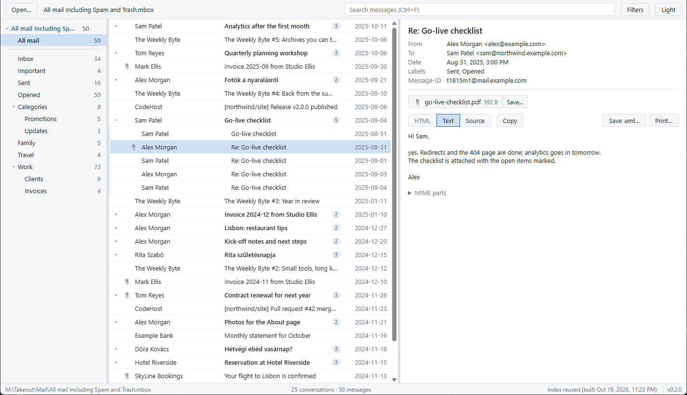

# mboxer

A fast, portable viewer for big Gmail Takeout mbox archives on Windows 11, with a macOS build as a preview: search
years of mail in well under a second, nothing to install.

[](https://github.com/speti4/mboxer/actions/workflows/ci.yml)
[](https://github.com/speti4/mboxer/releases/latest)
[](LICENSE)



## Features

- **Full-text search in milliseconds.** The first open builds an index beside the mbox (about two minutes and
  135 MB for a 14 GB archive); every later open takes under a second. Accents and case do not matter:
  `szamla` finds `Számla`.
- **Gmail as you know it.** Labels as a tree with counts, conversations, and Gmail-style operators (`from:`,
  `to:`, `subject:`, `after:`, `before:`, `has:attachment`, `label:`) with a filter panel that writes them.
- **Safe HTML mail.** Messages are sanitized and rendered in a sandbox that cannot reach the network; remote
  images load only when you ask.
- **Attachments** open with their default application or are saved, marked as downloaded from the internet;
  executables can only be saved.
- **Hand a message on** as an `.eml` file, print it, or save it as PDF.
- **Several archives at once**, for a split Takeout export or more than one export.
- **Light and dark**, following the system or your choice.
- **Never touches your mail.** The mbox is only read; the index is a cache you can delete any time.

## Requirements

- **Windows:** Windows 11 on x64. The viewer runs on the WebView2 runtime that is part of Windows 11.
- **macOS (preview):** macOS 10.13 or later, Apple Silicon or Intel (one universal app). The macOS build has not
  yet been tested on a Mac; reports are welcome.
- Free disk space next to the mbox for the search index: about 1 % of the mbox size.

## Download and start

The [latest release](https://github.com/speti4/mboxer/releases/latest) has one zip per platform;
[CHANGELOG.md](CHANGELOG.md) says what each release changed.

**Windows**

1. Download `mboxer-<version>.zip` and unzip it anywhere.
2. Start `mboxer.exe`. The exe is not code-signed, so SmartScreen may warn on the first start: *More info*,
   then *Run anyway*.
3. *Open* (`Ctrl+O`) your Takeout `.mbox` file and wait for the first index build.

**macOS (preview)**

1. Download `mboxer-<version>-macos.zip` and double-click it; move `mboxer.app` to *Applications*.
2. Open `mboxer.app`. The app is not notarized, so macOS blocks the first start: open *System Settings →
   Privacy & Security* and click *Open Anyway* next to the message about mboxer. macOS asks only once.
3. *Open* (`⌘O`) your Takeout `.mbox` file, or drop it on the app's Dock icon, and wait for the first index
   build.

**Check the download** (optional). `SHA256SUMS.txt` in the release holds the SHA-256 of both zips: compare it
with `(Get-FileHash mboxer-<version>.zip).Hash` in PowerShell, or with `shasum -a 256 mboxer-<version>-macos.zip`
on a Mac. Each zip also carries a build provenance attestation: with the [GitHub CLI](https://cli.github.com/),
`gh attestation verify <zip> --repo speti4/mboxer` shows that this repository's release workflow built it.

The [usage guide](docs/usage.md) (also inside the zip) covers the rest; the [reference](docs/reference.md)
describes every feature, the search syntax and the `mboxer-cli` command line.

**Found a bug?** [Open an issue](https://github.com/speti4/mboxer/issues/new/choose) and describe it with made-up
mail only, never your own messages. A security problem goes through the [security policy](SECURITY.md) instead.

## Build from source

mboxer is a Rust core with a Tauri 2 window on WebView2 (Windows) or WKWebView (macOS); why is in
[D-002](tasks/decisions/D-002-rust-tauri2-sidecar-fulltext-index.md). On Windows you need Rust stable with the
MSVC toolchain and the Visual Studio 2022 C++ build tools (details in [CONTRIBUTING.md](CONTRIBUTING.md)):

```powershell
cargo build --release
target\release\mboxer.exe [file.mbox]
```

On a Mac you need Rust stable and the Xcode command line tools (`xcode-select --install`): `cargo run -p
mboxer-app -- [file.mbox]` starts the viewer, and `scripts/bundle-macos.sh` builds the universal `mboxer.app` and
its zip ([development.md](docs/development.md#the-macos-bundle)).

## Documentation

- [Usage guide](docs/usage.md): for the people who only run it
- [Reference](docs/reference.md): the viewer, the search syntax, the index and the CLI
- [Development](docs/development.md): layout, CI, releases and helper scripts
- [Changelog](CHANGELOG.md): every release and the tasks it closed, with the zips and checksums on the
  [releases page](https://github.com/speti4/mboxer/releases)
- [Contributing](CONTRIBUTING.md) and the [security policy](SECURITY.md)
- [Why mboxer exists](docs/origin.md), [the alternatives it was measured against](docs/research/),
  [benchmarks](docs/benchmarks/)
- [Decisions](tasks/decisions/): the stack, the index, distribution, and why each

## Project status

The plan lives in [`tasks/`](tasks/README.md): the backlog, the work in flight and the history, one file per
item, with milestones in [`tasks/roadmap.md`](tasks/roadmap.md). The files are mirrored one way into
[issues](https://github.com/speti4/mboxer/issues) and [milestones](https://github.com/speti4/mboxer/milestones),
so the task files stay the only place to edit
([D-008](tasks/decisions/D-008-github-milestones-mirror-roadmap-one-way.md)). Windows is the main platform; the
macOS build ships as a preview until it has been tested on a Mac.

mboxer is for anyone who keeps an old mailbox as a Takeout export and wants to search it fast.

## Licence

[MIT](LICENSE)
